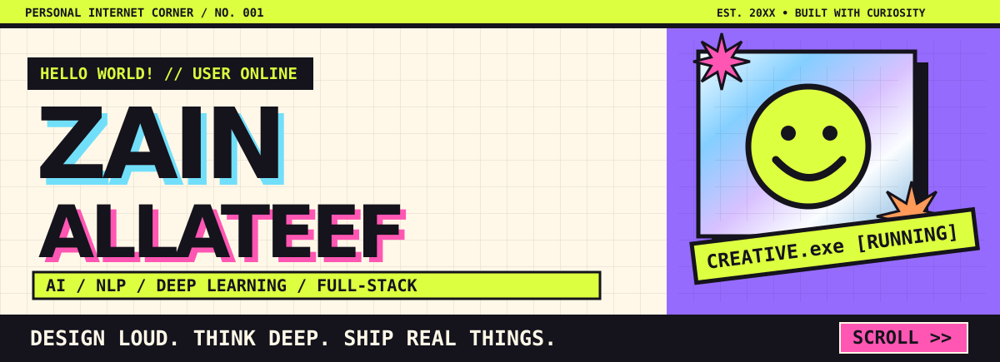
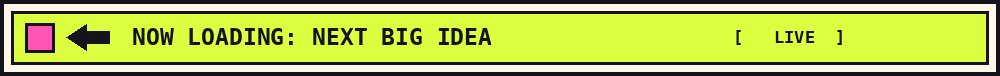
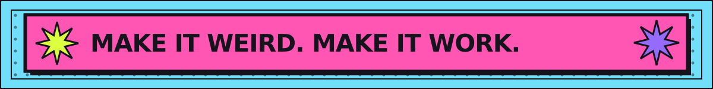
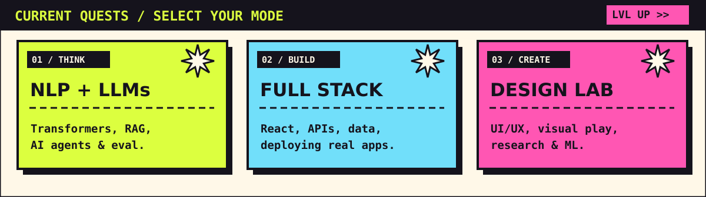
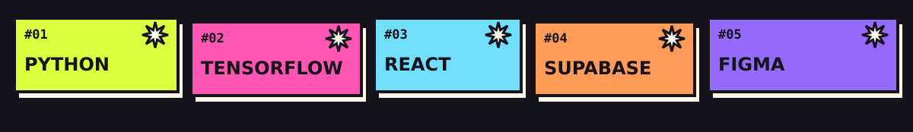
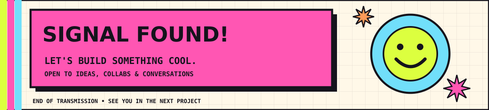

<!--
  ZAIN ALLATEEF / Y2K INTERNET EDITION
  Neo-brutalism × 2000s web nostalgia × retro pixel graphics
  Palette: #15131C ink / #FFF8E8 cream / #FF56B3 pink
           #DCFF3F lime / #71DFFA sky / #956BFE purple / #FF9A58 orange
  All visual artwork in ./assets is included with this README.
  Works on GitHub without CSS, JavaScript, or external image hosting for artwork.
-->

  

   
  

  
<strong>AI ENGINEERING ✳ NLP ✳ DEEP LEARNING ✳ FULL-STACK WEB</strong>

  
  
  

    
  

---

## `01 //` WHO'S BEHIND THE SCREEN? ✳

Hey, I'm **Zain** — an **Artificial Intelligence student** with a thing for making ideas *actually work*.

I build at the intersection of **machine learning, language, and software engineering**. My interests include **NLP, deep learning, Transformers, LLMs, RAG, AI agents**, and web apps that turn experiments into tools people can use.

I enjoy the full process: exploring the data, training and evaluating models, building the API, designing the interface, and figuring out what breaks along the way.

**My current energy:** curious researcher × practical builder × design nerd.

> **LEARN → EXPERIMENT → BREAK → FIX → SHIP → REPEAT.**

  

---

## `02 //` CURRENT QUESTS ★

  

**[01] AI & Language** — NLP, Transformers, retrieval-augmented generation, LLM applications, evaluation, and agents.

**[02] Software Engineering** — Full-stack interfaces, backend APIs, databases, automation, and reliable deployment.

**[03] Creative Problem-Solving** — UI/UX, computer vision, data science experiments, and research-driven products.

---

## `03 //` THE TOOLBOX ⚡

  

**`LANGUAGES`**

**`AI / DEEP LEARNING / DATA`**

**`WEB / DATABASES / DESIGN`**

  
<strong>⊞ OPEN EXTRA INVENTORY</strong>

   
  NumPy · Matplotlib · OpenCV · NLTK · spaCy · LangGraph · SQL Server · HTML · CSS · Laravel · Photoshop · Illustrator

---

## `04 //` PING ME ON THE INTERNET ↗

I like meeting people who are building in **AI, NLP, data, research, open source, and full-stack development**. Feel free to connect, share work, or start a conversation.

  
  
  

    
  

  ✳ SYSTEM STATUS: ALWAYS BUILDING ✳

