<!--
  GitHub profile README | Zain Allateef
  Sunset palette inspired by a winter portrait:
  Midnight #131923 · Charcoal #171D2A · Flame #EB873D · Amber #F6B274 · Cream #F6E6D7
  All custom illustrations are stored locally under ./assets for reliability.
-->

  

  

  
  

##  About me

I'm an **Artificial Intelligence student** who enjoys the intersection of **AI research, machine learning, and practical software development**. My main interests are **natural language processing (NLP), deep learning, language models, and intelligent applications**.

I also work across the full stack, from building responsive user interfaces to developing application logic and working with data. I like projects that go beyond a model in a notebook: systems people can actually interact with, test, and use.

My work so far includes **document question-answering with RAG, NLP classification experiments, machine learning projects, and browser-based tools**. I'm continuing to explore **AI agents, retrieval systems, model evaluation, and the engineering behind reliable AI products**.

> **My approach:** Learn the fundamentals. Experiment with ideas. Build something real. Improve it.

**Currently focused on:** `NLP` · `Deep Learning` · `RAG` · `LLMs` · `Agentic AI` · `Full-Stack Apps`

---

##  Featured projects

<table>
  <tr>
    <td width="50%" valign="top">
      <h3>01 / <a href="https://github.com/zaynallateef/pdf_RAG_system_qwenLLM">PDF RAG Q&amp;A</a></h3>
      
Question-answering over research PDFs using sentence embeddings, FAISS retrieval, and a local Qwen language model. Includes source-paper and page references.

      <code>Python</code> <code>RAG</code> <code>FAISS</code> <code>Qwen</code>
    </td>
    <td width="50%" valign="top">
      <h3>02 / <a href="https://github.com/zaynallateef/Emotion-Recognition-from-Text-CNN-vs-LSTM">Emotion Recognition</a></h3>
      
A deep learning comparison of 1D CNN and LSTM architectures for classifying emotions in text, with evaluation and error analysis.

      <code>NLP</code> <code>TensorFlow</code> <code>CNN</code> <code>LSTM</code>
    </td>
  </tr>
  <tr>
    <td width="50%" valign="top">
      <h3>03 / <a href="https://github.com/zaynallateef/forma">Forma — PDF Tools</a></h3>
      
A browser-based PDF toolkit for conversion, page editing, and English/Arabic OCR. Designed to run locally in the user's browser without an account.

      <code>React</code> <code>TypeScript</code> <code>Vite</code> <code>OCR</code>
      
<a href="https://forma-6l6.pages.dev/">Live website</a>

    </td>
    <td width="50%" valign="top">
      <h3>04 / <a href="https://github.com/zaynallateef/KaggleJo">KaggleJo</a></h3>
      
A searchable directory and leaderboard for Kaggle community members who publicly list Jordan as their location, with filtering and comparisons.

      <code>Flask</code> <code>SQLite</code> <code>React</code> <code>Tailwind CSS</code>
    </td>
  </tr>
</table>

<a href="https://github.com/zaynallateef?tab=repositories">Explore all repositories →</a>

---

##  Tools & technologies

**Languages**

  
  
  
  
  

**Web development**

  
  
  
  
  
  
  

**AI, machine learning & data**

  
  
  
  
  
  
  
  
  

**Databases & design**

  
  
  
  
  

<b>What I'm exploring next</b>

 
Retrieval-augmented generation, agent workflows with LangChain / LangGraph, vector search, evaluation pipelines, and deploying AI-powered web applications.

---

##  Let's connect

I enjoy collaborating on **AI, NLP, data, and full-stack projects**, sharing ideas, and learning from other builders.

- **LinkedIn:** [zain-allateef](https://www.linkedin.com/in/zain-allateef/)
- **GitHub:** [@zaynallateef](https://github.com/zaynallateef)

 

  

