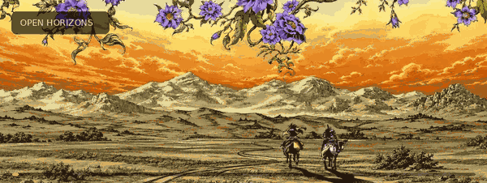

<!--
  Zain Allateef / GitHub profile
  Theme: NIGHT VISION + DREAMSCAPES
  Palette: #0B0B14 (ink) / #FF4056 (eye red) / #B164DD (violet) / #FFA35C (sunset) / #F5E6DE (cream)
  GIF assets are included under assets/ and play automatically on GitHub.
-->

  

  <h1>Hi, I'm Zain Allateef </h1>
  
<b>Artificial Intelligence Student · NLP & Deep Learning · Full-Stack Developer</b>

  
   
  
  

---

###  About Me

I'm an **Artificial Intelligence student** interested in how we can turn research, algorithms, and data into useful software. My strongest interests are **natural language processing, deep learning, machine learning, and intelligent applications**.

I build across the stack as well, from responsive **React** interfaces to backend logic and data workflows. I particularly enjoy making AI projects feel like real products rather than leaving them as experiments in a notebook.

I've worked on **RAG-based document question answering, text classification, machine learning experiments, and browser-based tools**. Along the way I'm exploring **LLMs, AI agents, retrieval pipelines, and more reliable ways to build and evaluate AI systems**.

Outside a single tech stack, I enjoy design, problem-solving, and exploring new ideas. I learn by building, testing, breaking, and improving things.

> **Always learning. Always building. Always exploring.**

`NLP` · `Deep Learning` · `LLMs` · `RAG` · `AI Engineering` · `Full-Stack Development`

---

###  Visual Interlude

  
  Four worlds. One loop. A little visual inspiration between the code.

---

###  Tech & Tools

**Languages**

  
  
  
  
  

**AI / Machine Learning / Data**

  
  
  
  
  
  
  
  
  

**Web Development**

  
  
  
  
  
  
  

**Databases & Creative Tools**

  
  
  
  
  

  
<b>Currently exploring ▸</b>

  
AI agents · LangChain / LangGraph · vector search · hybrid retrieval · LLM evaluation · AI-powered applications

---

###  Say Hello

Interested in **AI, NLP, machine learning, creative coding, or full-stack projects**? I'm always open to exchanging ideas and learning from other builders.

  
  

  
   
  ✦ See you in the next project ✦

