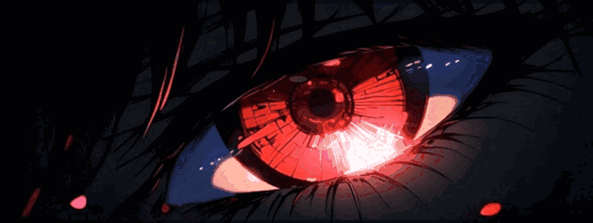
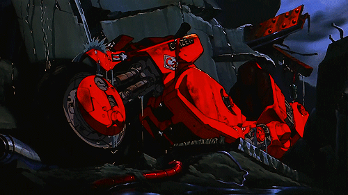
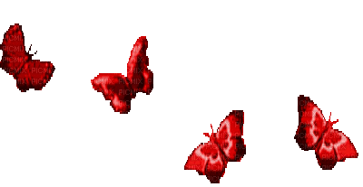

<!--
  Zain Allateef — Crimson Minimal / Dark Anime
  Palette: #100B12 (ink) / #21141D (shadow) / #C82037 (crimson)
           #FF6176 (soft red) / #FFDCE2 (pale pink)
  Notes: no scripts, CSS, or external image hosting required for local GIFs.
-->

  
  <h1>ZAIN ALLATEEF</h1>
  <strong>AI Engineering · Natural Language Processing · Full-Stack Development</strong>
    
  
   
  
  
  

---

##  ABOUT ME

I'm an **Artificial Intelligence student** who enjoys building software where **machine learning, language, and real-world problems** meet. I'm particularly interested in **NLP, deep learning, LLMs, retrieval-augmented generation (RAG), and intelligent applications**.

I have hands-on experience with **full-stack development**, Python, data analysis, and machine learning. I like taking ideas beyond experiments and turning them into tools that people can actually try, use, and improve.

My recent work spans **document question answering, text classification, ML experiments, and browser-based utilities**. I also enjoy design, competitive problem-solving, and learning how to make AI applications more reliable.

> *Always learning. Always building. Always exploring.*

  

---

##  WHAT I'M EXPLORING

**AI & language** — NLP, Transformers, deep learning, RAG, LLMs, evaluation, and AI agents.

**Software engineering** — React interfaces, backend APIs, databases, and production-oriented workflows.

**Creative problem-solving** — Data analysis, UI/UX, experimentation, and research-driven projects.

  

---

##  TECH STACK

**Languages**

**AI / Data**

**Web & Tools**

  
<strong>More tools & libraries</strong>

  
NumPy · NLTK · spaCy · OpenCV · Matplotlib · HTML · CSS · Laravel · SQL Server · Photoshop · Illustrator

  

---

##  LET'S CONNECT

Always interested in connecting with people working on **AI, NLP, data, research, and full-stack development**.

  
  
  
    
  
   
  ✦ See you in the next project ✦

